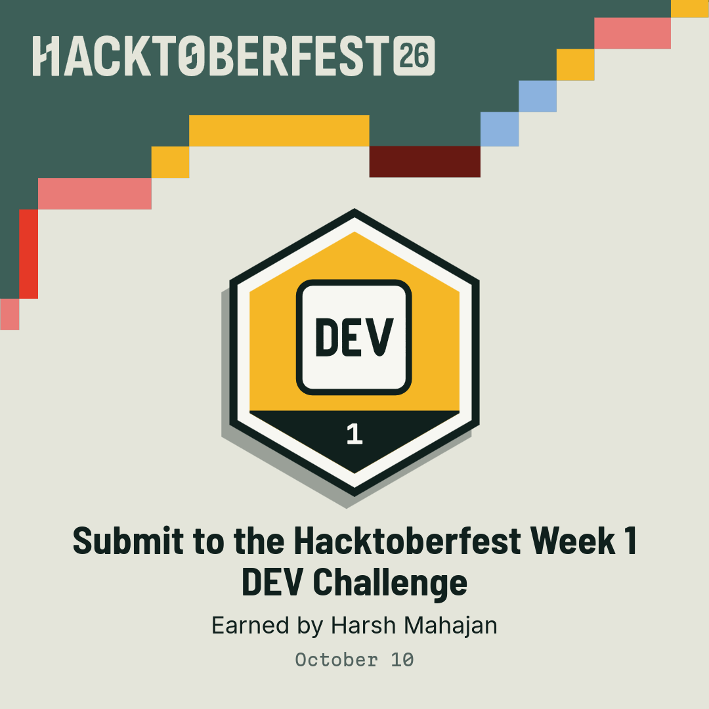
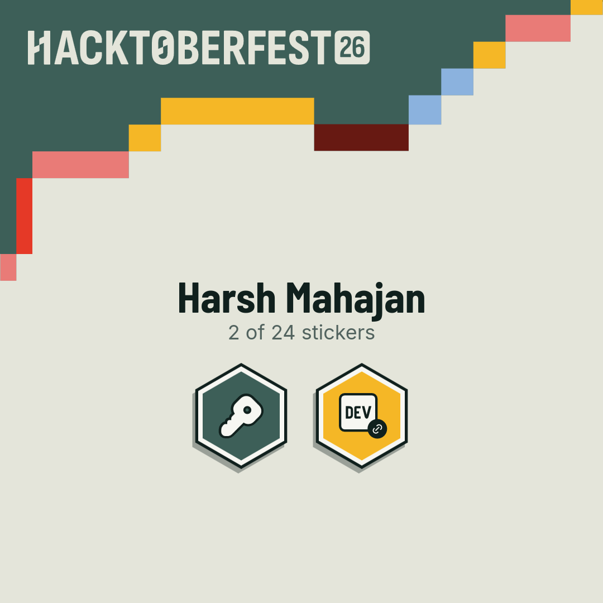
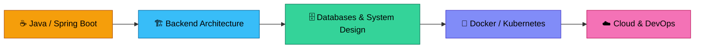

  

 

## 👋 About Me

> *Building systems that real people rely on, one deploy at a time.*

I'm a **backend-focused developer** working with **Java, Spring Boot, databases, distributed systems and DevOps**. I like building systems where the backend has to deal with real data, business rules, concurrency, persistence and deployment, rather than basic CRUD APIs alone.

I also build projects that expose how systems work internally, instead of relying entirely on frameworks.

<table>
  <tr>
    <td>🔭 <b>Working on</b></td>
    <td>Production admission platform for Walchand College of Engineering, Sangli</td>
  </tr>
  <tr>
    <td>🌱 <b>Learning</b></td>
    <td>System design, database internals, Kubernetes, OAuth2</td>
  </tr>
  <tr>
    <td>⚡ <b>Fun fact</b></td>
    <td>I built my own Redis-style database server from scratch in plain Java</td>
  </tr>
  <tr>
    <td>🎯 <b>Goal</b></td>
    <td>Become a strong backend and DevOps engineer</td>
  </tr>
</table>

 

## 🎃 Hacktoberfest 2026

&nbsp;&nbsp;&nbsp;

 

**Earned the Week 1 DEV Challenge badge · 2 of 24 stickers collected and counting**

 

## 🚀 Featured Projects

<table>
  <tr>
    <td width="50%" valign="top">

### 🎓 WCE Admission Management System
Production admission platform for **Walchand College of Engineering, Sangli**, running on live data under real institutional deadlines.

**1,200+** registrations &nbsp;·&nbsp; **₹12L+** in online transactions

- Tracks: MHT-CET, JEE Main, Diploma, OMS, M.Tech Sponsored
- Eligibility and category-based admission rules
- Dynamic merit lists with tie-breaking
- Seat allocation with seat locking to prevent duplicates
- Real-time admin dashboard and large Excel exports (Apache POI `SXSSFWorkbook`)
- Payment verification and webhook processing

`Java` `Spring Boot` `PostgreSQL` `Docker` `AWS` `GitHub Actions`

</td>
    <td width="50%" valign="top">

### ⚡ MiniRedis
Redis-inspired **in-memory database server** built from scratch in plain Java, working directly with networking, concurrency and storage.

- Custom TCP client-server with concurrent clients
- String and List types: `SET`, `GET`, `LPUSH`, `RPOP`
- TTL-based key expiration
- Thread-safe storage with persistence and recovery
- RESP-inspired protocol and custom command parsing

`Java` `TCP` `Multithreading` `Maven`

</td>
  </tr>
  <tr>
    <td width="50%" valign="top">

### 🔗 QuickShare
Temporary file sharing through **6-digit access codes**, focused on file handling, REST APIs and deployment.

- File upload through a REST API
- Unique 6-digit code per upload
- Retrieval through a `/share` workflow
- Metadata stored in PostgreSQL
- Separate frontend and backend, both on the cloud

`Spring Boot` `PostgreSQL` `JavaScript` `Vercel` `Render`

</td>
    <td width="50%" valign="top">

### 🗂️ FileShare
File storage backend that combines **PostgreSQL metadata** with **external object storage**.

- REST APIs for upload and retrieval
- Large file upload and download handling
- Clear separation of metadata and file content
- Cloud-based deployment architecture

`Spring Boot` `PostgreSQL` `Object Storage` `REST API`

</td>
  </tr>
  <tr>
    <td colspan="2" valign="top">

### 🅿️ Parking Management System
Models vehicle entry, slot allocation and exit workflows using OOP design and transactional database operations.

- Vehicle entry and exit management
- Parking-slot allocation and record persistence
- PostgreSQL with transaction-based operations
- React frontend, plus database export and import

`Java` `OOP` `PostgreSQL` `React` `Database Transactions`

</td>
  </tr>
</table>

 

## 🛠️ Tech Stack

**Languages** 

**Backend** 

**Databases** 

**DevOps and Infrastructure** 

**Frontend and Tools** 

 

## 📊 GitHub Stats

 

 

 

## 🧩 Competitive Programming

| Platform | Progress |
| :---: | :---: |
| 🟠 **LeetCode** | 350+ problems solved |
| 🟤 **CodeChef** | 2-star |
| 🔵 **Codeforces** | Active practice |

**Focus areas:** `Arrays & Strings` `Hashing` `Two Pointers` `Sliding Window` `Binary Search` `Stack & Queue` `Linked Lists` `Trees` `Graphs` `Dynamic Programming`

 

## 🗺️ Learning Roadmap

 

### 🤝 Let's Connect

